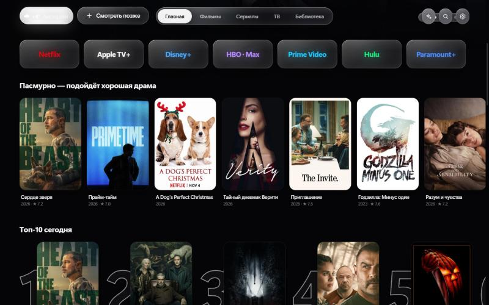
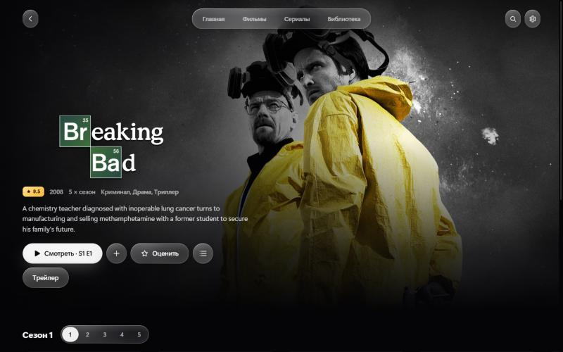
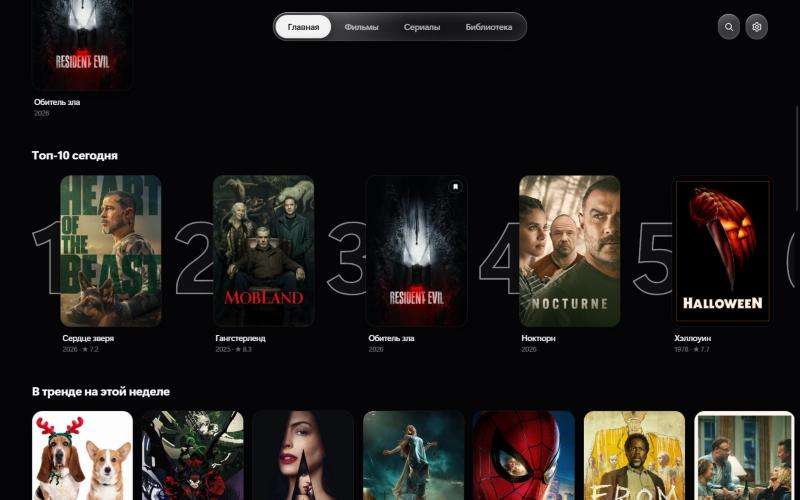
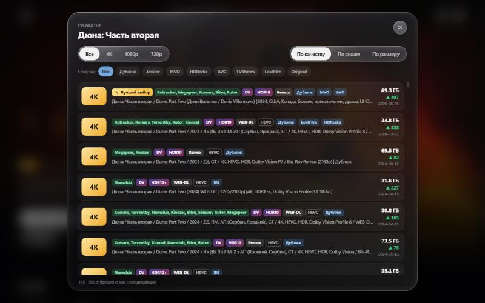
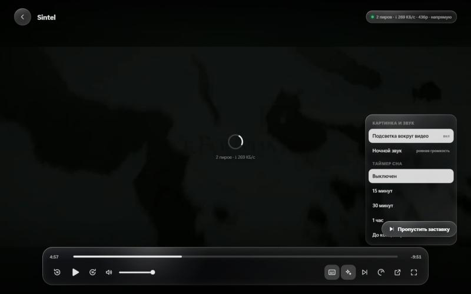
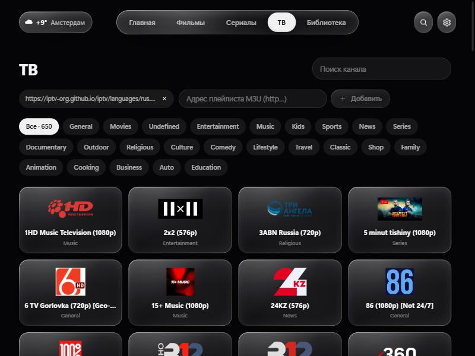

# 🎬 Cinema

**Фильмы и сериалы из торрентов — сразу, без ожидания загрузки.**
Красивый интерфейс в духе Apple TV, управление пультом, автообновление.

## ⬇️ Скачать

| Устройство | Файл | Как установить |
|---|---|---|
| 🖥️ **Windows 10 / 11** | [`Cinema_x64-setup.exe`](https://github.com/killnaive/cinema-releases/releases/latest) | Скачайте и запустите — установка займёт полминуты |
| 📺 **Android TV, приставки, телефоны** | [`Cinema-android.apk`](https://github.com/killnaive/cinema-releases/releases/latest) | Скопируйте на устройство и откройте файловым менеджером (нужно разрешить установку из неизвестных источников) |

Все файлы — на странице **[последнего выпуска](https://github.com/killnaive/cinema-releases/releases/latest)**.
Дальше приложение обновляется само: найдёт новую версию и предложит поставить её одной кнопкой.

## ✨ Что умеет

- ⚡ **Смотреть сразу.** Видео идёт прямо из раздачи — не нужно ждать, пока скачается фильм. Приложение само выбирает лучшую живую раздачу и начинает за секунды.
- 🔎 **Без настройки.** Каталог, поиск раздач и плеер работают сразу после установки — никаких ключей, Jackett и сторонних программ.
- 🎞️ **4K, HDR, Dolby Vision.** Видео не пережимается — качество как в оригинале. Звук 5.1, выбор озвучки и субтитров, приложение запоминает ваш выбор.
- 📺 **Для телевизора.** Крупный интерфейс, всё управляется пультом, родной плеер Android с передачей Dolby и DTS на ресивер. Название можно набрать с телефона по QR-коду.
- 🧊 **Красиво.** Тёмная тема с «жидким стеклом», постеры, трейлеры, погода с дождём и снегом на главной.
- 📚 **Библиотека.** «Смотреть позже», оценки, история и «Продолжить просмотр» с того же места. Профили для всей семьи.
- 📡 **ТВ-каналы.** Плейлисты IPTV (M3U) с группами, поиском и избранным.
- ⏭️ **Удобно смотреть сериалы.** Пропуск заставки и титров, автопереход к следующей серии.
- 🌍 **Три языка:** русский, украинский, английский.

## 📸 Скриншоты

| | |
|:---:|:---:|
|  |  |
| Страница сериала | Топ-10 на главной |
|  |  |
| Выбор раздачи: качество, озвучка, сиды | Плеер: озвучка, субтитры, скорость |
|  | |
| ТВ-каналы | |

## ❓ Вопросы

<b>Windows предупреждает «Система Windows защитила ваш компьютер»</b>

Установщик не подписан платным сертификатом Microsoft, поэтому SmartScreen его не знает. Нажмите **«Подробнее» → «Выполнить в любом случае»**.

<b>Как обновиться?</b>

Ничего делать не нужно: приложение проверяет обновления при запуске и раз в 12 часов, а затем предлагает установить новую версию. Проверить вручную можно в **Настройки → Обновления**. На Android при первом обновлении система попросит разрешить установку приложений — разрешите один раз.

<b>Фильм долго не запускается</b>

Скорость зависит от раздачи: чем больше сидов, тем быстрее старт. Приложение само перебирает несколько лучших раздач и запоминает трекеры, которые не отвечают. Если не повезло — выберите другую раздачу вручную, кнопкой «Раздачи» на странице фильма.

<b>Безопасны ли обновления?</b>

Каждый файл подписан ключом автора. Приложение проверяет подпись перед установкой и отказывается ставить файл, если он подменён или повреждён.

---

Сделано на Rust, Svelte и Tauri · Каталог — TMDB · Приложение только показывает то, что уже раздаётся в сети, и ничего не хранит на своих серверах

